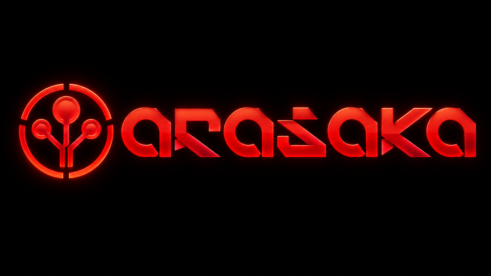

# ARASAKA — DeepData Hackathon 3.0



Private preparation repository for our four-person team: reusable tabular ML baselines, CSV profiling, Streamlit EDA, and timed mock challenges.

**Event (from the shared poster):** 23 October 2026, 9:00 AM–4:00 PM, K.R. Mangalam University. Teams of 2–4. Challenge/datasets revealed on the day. **Verify organizer rules for prebuilt code, AI tools, Wi-Fi, and external packages before using this kit at the event.**

This is a reusable **practice scaffold**, not a hackathon solution. The two bundled datasets are **completely synthetic**, and the exercises/point rubric are **our own practice material**, not the organizer's official tasks or criteria.

## Clone the private repository

Install Git and Python **3.12**. Accept the GitHub collaborator invitation first,
then run these commands in your terminal (PowerShell, Command Prompt, macOS, or Linux):

```text
git clone https://github.com/farhanakhtar0x66/arasaka-deepdata-2026.git
cd arasaka-deepdata-2026
```

If GitHub asks you to sign in, use its browser sign-in flow or a credential manager.
For “Repository not found,” check that the invitation was accepted and Git is using
the invited account. The setup commands below assume you are in this repository folder.

## Quick start (Linux / macOS)

Requirements: **Python 3.12**, 1–2 GB of free disk space and a terminal. The exact dependency set is in `requirements-lock.txt`; `requirements.txt` retains the original supported version ranges.

```bash
python3.12 -m venv .venv
source .venv/bin/activate
python -m pip install --upgrade pip
python -m pip install -r requirements-lock.txt
```

## Quick start (Windows)

Use **Python 3.12** and either **PowerShell** or **Command Prompt (cmd.exe)**. Run commands from the cloned project folder containing `requirements-lock.txt`, `app.py`, and `scripts/`. Skip cloning if you are already in that folder.

### PowerShell

```powershell
py -3.12 -m venv .venv
.\.venv\Scripts\Activate.ps1
python -m pip install --upgrade pip
python -m pip install -r requirements-lock.txt
```

If `py` is unavailable but `python --version` reports Python 3.12, use `python -m venv .venv` instead.

If PowerShell says that running scripts is disabled, use the virtual environment's Python directly; activation is optional and no execution-policy change is needed:

```powershell
.\.venv\Scripts\python.exe -m pip install --upgrade pip
.\.venv\Scripts\python.exe -m pip install -r requirements-lock.txt
```

For each command below, replace the initial `python` with `.\.venv\Scripts\python.exe` when using this approach.

### Command Prompt (cmd.exe)

```bat
py -3.12 -m venv .venv
.venv\Scripts\activate.bat
python -m pip install --upgrade pip
python -m pip install -r requirements-lock.txt
```

If `py` is unavailable, use `python -m venv .venv` after checking that `python --version` reports Python 3.12.

### Run the tools on Windows

After activating the environment, these **single-line commands work in both PowerShell and Command Prompt**. Run them from the project folder. The multiline Bash examples below use `\` for continuation; use these single-line versions on Windows.

Profile the synthetic water CSV:

```text
python scripts/profile_data.py --data data/mock_water_network.csv --target failed_next_30d
```

Train the classification baseline:

```text
python scripts/train_baseline.py --data data/mock_water_network.csv --target failed_next_30d --drop pipe_id repair_cost_after_event_inr --time-col inspection_date --out outputs/water_model
```

Train the regression baseline:

```text
python scripts/train_baseline.py --data data/mock_delivery_times.csv --target delivery_minutes --drop order_id customer_review_after_delivery --time-col order_placed_date --out outputs/delivery_model
```

Launch the dashboard:

```text
python -m streamlit run app.py
```

Open the local URL printed in the terminal (usually `http://localhost:8501`). Press **Ctrl+C** to stop the dashboard. Run `deactivate` to leave an activated environment. Each new terminal needs activation again, or you can use `.\.venv\Scripts\python.exe` directly.

## Run the tools (Linux / macOS)

### Profile a CSV

```bash
python scripts/profile_data.py \
  --data data/mock_water_network.csv \
  --target failed_next_30d
```

Creates `outputs/profile/{summary.txt,column_profile.csv,sample_rows.csv,numeric_summary.csv}`.

### Train a classification baseline (synthetic water dataset)

```bash
python scripts/train_baseline.py \
  --data data/mock_water_network.csv \
  --target failed_next_30d \
  --drop pipe_id repair_cost_after_event_inr \
  --time-col inspection_date \
  --out outputs/water_model
```

**Why these exclusions?** `pipe_id` is a unique ID. `repair_cost_after_event_inr` is only logged after a failure, so including it would cheat. The date controls a chronological train/validation/test split, and is not fed into the baseline model.

Results: `outputs/water_model/metrics.json`, `test_predictions.csv`, `confusion_matrix.png`, `model.joblib`.

### Train a regression baseline (synthetic delivery dataset)

```bash
python scripts/train_baseline.py \
  --data data/mock_delivery_times.csv \
  --target delivery_minutes \
  --drop order_id customer_review_after_delivery \
  --time-col order_placed_date \
  --out outputs/delivery_model
```

For regression, compare MAE and RMSE **against the dummy baseline**, not against classification accuracy.

### Launch the dashboard

```bash
python -m streamlit run app.py
```

Open the local URL Streamlit prints (usually `http://localhost:8501`). You can upload a fresh CSV. The dashboard performs descriptive analytics only; it does **not** automatically train or deploy a model.

## Team workflow and checks

Use a feature branch and pull request for each task; the captain reviews and merges.
See [CONTRIBUTING.md](CONTRIBUTING.md) for copyable Git commands. Roles in the
original playbook remain provisional until the team agrees them.
GitHub requires a Pro upgrade to enforce branch protection on this private
repository under the current account plan. Follow this review workflow manually;
`main` is currently unprotected.

After setup, run the same checks used by GitHub Actions:

```text
python -m pip check
python -m unittest discover -s tests -v
```

GitHub Actions installs the pinned dependencies and runs these checks on Windows
and Linux with Python 3.12. Tests cover both modeling paths, data profiling,
leakage rejection, split integrity, training-only imputation, dataset generation,
and dashboard startup/filtering. Outputs from tests go to temporary directories.

Keep the synthetic practice data in `data/` separate from the real event data.
Use [competition/](competition/README.md) after the organizer reveals the brief.
Generated `outputs/`, competition data, environments, and secrets are ignored by Git.
The ZIP's example outputs remain available in the original ZIP and the local
ignored `outputs/` directory; regenerate fresh results with the commands above.

Read [the import audit](docs/STARTER_AUDIT.md) for verified results and limitations,
and [the October 19–22 readiness plan](docs/READINESS_PLAN.md) for preparation.

## Folder guide

| File | Purpose |
|---|---|
| `11_DAY_PLAN.md` | Original training plan, preserved as reference |
| `docs/READINESS_PLAN.md` | Focused October 19–22 preparation |
| `requirements-lock.txt` | Exact dependency versions used by CI |
| `tests/` | Smoke and regression checks |
| `competition/` | Separate workspace for the real brief |
| `TEAM_PLAYBOOK.md` | Responsibilities and event-day timeboxes |
| `DATA_SCIENCE_CHEATSHEET.md` | Core commands, models, metrics, safety checks |
| `app.py` | Streamlit explorer |
| `scripts/profile_data.py` | Quick profiling of any CSV |
| `scripts/train_baseline.py` | Binary classification / regression starter |
| `scripts/generate_mock_data.py` | Recreate synthetic water data (fixed seed) |
| `scripts/generate_mock_regression.py` | Recreate synthetic delivery data (fixed seed) |
| `data/*.csv` | Two original practice datasets |
| `mock_challenge/CHALLENGE_1.md` | Timed challenge #1: pipe failures |
| `mock_challenge/CHALLENGE_2.md` | Timed challenge #2: delivery time |
| `mock_challenge/HINTS_AND_SOLUTIONS.md` | **SPOILERS** — open after mocks |
| `mock_challenge/PRACTICE_RUBRIC.md` | Self-scoring, not official judging criteria |

## Minimal workflow for an unknown dataset

1. Read the problem and scoring requirements. Write one prediction/analysis objective.
2. Identify row meaning, unique IDs, timestamp(s), target and columns available at decision time.
3. Profile missingness, duplicates, group boundaries, outliers and target prevalence.
4. Choose a split that matches deployment: **chronological** for future predictions; **group-aware** when multiple records per customer/pipe/site; otherwise stratify for classification.
5. Create a dumb baseline. Then try a Pipeline that fits imputers/encoders **only on training data**.
6. Select hyperparameters/threshold using validation data, not the test set.
7. Report a holdout metric suited to the real decision; report uncertainty and failure cases.
8. Show two or three verified insights and the action each supports.
9. Keep the presentation reproducible, honest, and concise.

**Limitations:** The provided model script supports binary classification and numeric regression, not time-series forecasting, text/image models, group-aware splits, or multiclass classification. It checks only *some* leak-looking field names; reviewing dataset provenance manually remains mandatory. It is a baseline, not an automatic high-scoring solution. Do not load `.joblib` files from untrusted sources.

## Shared learning sources

- Pandas: https://pandas.pydata.org/docs/getting_started/intro_tutorials/index.html
- scikit-learn common pitfalls: https://scikit-learn.org/stable/common_pitfalls.html
- scikit-learn model evaluation: https://scikit-learn.org/stable/modules/model_evaluation.html
- Streamlit docs: https://docs.streamlit.io/get-started
- Kaggle Learn: https://www.kaggle.com/learn
